<p align="center">
  
</p>

# Awesome Geospatial Visualization

<p align="center">
  <a href="https://github.com/sindresorhus/awesome"></a>
  <a href="https://github.com/ishandutta2007/Awesome-Geospatial-Visualization/stargazers"></a>
  <a href="https://github.com/ishandutta2007/Awesome-Geospatial-Visualization/blob/main/LICENSE"></a>
  <a href="https://github.com/ishandutta2007/Awesome-Geospatial-Visualization/pulls"></a>
  <a href="#table-of-contents"></a>
</p>

A curated directory of top-tier **Software-as-a-Service (SaaS) platforms** and **open-source GitHub projects** dedicated to **Geospatial Visualization**, **Interactive Web Mapping**, **Large-Scale Spatial Analytics**, and **Cloud & Desktop GIS**.

Whether you are building GPU-accelerated web dashboards, processing petabytes of Earth observation imagery in cloud data warehouses, or hosting air-gapped 3D globes and map tile servers, this collection provides benchmarks, pricing structures, and capability breakdowns for the global geospatial ecosystem.

---

## Table of Contents

- [Sector Overview & Market Dynamics](#sector-overview--market-dynamics)
- [SaaS & Commercial Hosted Platforms](#saas--commercial-hosted-platforms)
- [Open-Source GitHub Projects](#open-source-github-projects)
  - [Open-Source Projects Index (Sorted by Stars)](#open-source-projects-index-sorted-by-stars)
  - [Detailed Project Profiles](#detailed-project-profiles)
- [Architectural Decision Guide](#architectural-decision-guide)
- [How to Contribute](#how-to-contribute)
- [Disclaimer & Licensing](#disclaimer--licensing)

---

## Sector Overview & Market Dynamics

The global geospatial analytics and GIS visualization market was valued at **$88.3 Billion in 2024** and is projected to expand to **$205.4 Billion by 2030**, exhibiting a robust compound annual growth rate (**CAGR of 15.1%**). This acceleration is propelled by cloud data warehouse spatial engines (BigQuery, Snowflake, Databricks), GPU-accelerated browser rendering (WebGL/WebGPU), satellite Earth observation constellations, real-time IoT telematics, and autonomous spatial navigation systems.

The market structure demonstrates **moderate fragmentation with high bifurcated concentration**: enterprise GIS infrastructure and spatial system-of-record governance remain tightly consolidated around legacy powerhouses—primarily **Esri** alongside enterprise analytics giants **Microsoft** and **Salesforce**—while the cloud-native spatial data science, web mapping API, and vector tile infrastructure tiers are actively fragmented. In these developer-driven layers, specialized agile innovators (such as **Mapbox** and **CARTO**) compete and co-exist with a thriving, vendor-neutral open-source commons (**MapLibre**, **QGIS**, **Cesium**, **deck.gl**, and **Leaflet**) that mitigates vendor lock-in and delivers sovereign, cost-predictable geospatial architectures.

---

## SaaS & Commercial Hosted Platforms

The table below outlines leading enterprise geospatial and location intelligence SaaS providers, ordered by **Company Scale (Valuation / Market Capitalization / Annual Revenue, Descending)**.

| Platform / Product | Parent / Vendor | Company Scale (Revenue / Valuation) | Starting Tier Pricing | Free Tier / Trial Limits | Core Spatial Capabilities & Key Use Cases |
| :--- | :--- | :--- | :--- | :--- | :--- |
| **[Power BI Maps](https://powerbi.microsoft.com/)** | Microsoft (NASDAQ: MSFT) | **~$3.1 Trillion** MCap (FY24 Rev: $245.1B) | **$10.00** / user / month *(Power BI Pro)* | **Free forever** via Power BI Desktop (local authoring, 1 GB dataset/model limit, no cloud sharing); **60-day free trial** of Power BI Pro (10 GB model limit, full workspace sharing). | Built-in Azure/Bing Maps and ArcGIS for Power BI visuals; best for enterprise dashboards, KPI spatial cross-filtering, and Microsoft 365 / Fabric ecosystem data. |
| **[Google Earth Engine](https://earthengine.google.com/)** | Alphabet / Google (NASDAQ: GOOGL) | **~$2.1 Trillion** MCap (FY24 Rev: $307.4B) | **$500.00** / month *(Commercial Basic Package with 100 EECU-hours/mo compute)* | **Free forever** for non-commercial research, academic, and non-profit usage (250 GB asset storage, shared compute quotas); **90-day / $300 credit free trial** for Google Cloud Platform commercial evaluation. | Multi-petabyte satellite and planetary imagery catalog; server-side planetary-scale raster processing, temporal land change analysis, and climate modeling. |
| **[Tableau](https://www.tableau.com/)** | Salesforce (NYSE: CRM) | **~$270 Billion** MCap (FY24 Rev: $34.9B; Tableau acquired for $15.7B) | **$15.00** / user / month *(Tableau Viewer, billed annually)*; Creator seat is **$75.00** / user / month | **Free forever** via Tableau Public (unlimited public visualizations, max 10 Million rows / 10 GB per workbook; workbooks must be published publicly); **14-day fully featured free trial** of Tableau Desktop/Creator. | BI mapping with dual-axis spatial layers, point clusters, polygon joins, spatial file connectors (Shapefile, GeoJSON, KML), and spatial database connectivity. |
| **[MicroStrategy Geospatial](https://www.microstrategy.com/)** | MicroStrategy (NASDAQ: MSTR) | **~$45 Billion** MCap (FY23 Rev: $496M) | **$15.00** / user / month *(MicroStrategy Cloud Consumer / Viewer)*; Starter environment from **$2,000.00** / month | **30-day free trial** of MicroStrategy Cloud (up to 5 named users, 10 GB cloud storage, full interactive geospatial dossier visualization access). | Enterprise spatial intelligence embedded in BI dossiers; Esri ArcGIS map integration, vector map styles, dynamic geofencing, and multi-layer thresholding. |
| **[Hexagon Geospatial](https://www.hexagongeospatial.com/)** | Hexagon AB (STO: HEXA-B) | **~$26 Billion** MCap (FY23 Rev: ~$5.7B) | **$125.00** / user / month *(approx. $1,500/yr starting license for M.App Enterprise)* | **30-day evaluation trial** (upon enterprise request, includes full access to M.App Enterprise or ERDAS IMAGINE desktop/web suite with demo spatial data). | Remote sensing, photogrammetry, defense/infrastructure GIS, smart city digital twins, point cloud 3D analytics, and airborne LiDAR processing. |
| **[ArcGIS Insights](https://www.esri.com/en-us/arcgis/products/arcgis-insights/overview)** | Esri (Environmental Systems Research Institute) | **~$12 Billion – $15 Billion** Est. Valuation (Annual Rev: ~$1.8B–$2.0B) | **$46.50** / user / month *($558/user/year add-on; requires ArcGIS Online Creator at $550/yr, total starting at ~$92.33/user/month)* | **Free forever** Developer Plan (2,000,000 basemap/geocoding tile requests/mo, 100 MB data storage); **21-day free trial** of ArcGIS Online (up to 5 users, 200 service credits, full Insights workbook access). | Gold standard for enterprise spatial data science; linked interactive cards (maps, charts, tables), spatial regression, link/flow analysis, and Python/R spatial notebook integration. |
| **[Alteryx Spatial](https://www.alteryx.com/)** | Clearlake Capital / Insight Partners | **$4.4 Billion** Valuation (Acquired Dec 2023; Annual Rev: ~$1.0B) | **$432.92** / user / month *($5,195/user/year for Alteryx Designer, billed annually)* | **30-day fully functional free trial** of Alteryx Designer (includes full Spatial tool palette: trade areas, spatial joins, drive-time generation, spatial match). | No-code/low-code spatial ETL and location intelligence pipelines; spatial clustering, drivetime radius generation, retail catchment trade-area analytics. |
| **[Mapbox Studio](https://www.mapbox.com/mapbox-studio/)** | Mapbox | **~$2.0 Billion** Valuation ($400M+ venture funding) | **$5.00** / 1,000 web map loads & **$2.00** / 1,000 geocoding requests *(pay-as-you-go above free tiers)* | **Free forever** allowance every month: **50,000 web map loads**, **25,000 mobile MAUs**, **100,000 geocoding requests**, **50,000 static map requests**, and unlimited Studio design access. | Custom cartographic design platform, vector tileset pipeline (MTS), high-framerate 3D terrain rendering, navigation routing, and high-volume consumer app map styling. |
| **[CARTO](https://carto.com/)** | CARTO | **~$250 Million** Valuation ($61M Series C; ~$25M ARR) | **$199.00** / month *($149/mo billed annually for Individual Cloud Plan; Basemaps starting tier at $500/mo)* | **Free forever** Basemaps tier for non-commercial projects up to **5,000,000 requests/month** (1,000,000 for commercial); **14-day fully featured free trial** of CARTO Cloud Builder & Data Warehouse connectors. | Cloud-native spatial analytics engine executing directly inside Snowflake, BigQuery, Databricks, and Redshift; powered by deck.gl and Kepler.gl with Overture Maps data. |

---

## Open-Source GitHub Projects

### Open-Source Projects Index (Sorted by Stars)

The table below lists top open-source projects sorted by GitHub star count in descending order. Each badge links directly to the repository's stargazers page:

| Project Name | GitHub Star Badge (Click to View Stargazers) | Primary Domain | Core Tech Stack | License |
| :--- | :--- | :--- | :--- | :--- |
| **[Leaflet](https://github.com/Leaflet/Leaflet)** | [](https://github.com/Leaflet/Leaflet/stargazers) | Lightweight Mobile-Friendly Interactive Web Maps | JavaScript | BSD-2-Clause |
| **[CesiumJS](https://github.com/CesiumGS/cesium)** | [](https://github.com/CesiumGS/cesium/stargazers) | 3D Globes, Digital Twins & 3D Tiles Streaming | JavaScript / WebGL | Apache-2.0 |
| **[deck.gl](https://github.com/visgl/deck.gl)** | [](https://github.com/visgl/deck.gl/stargazers) | WebGL2 / WebGPU Large-Scale Spatial Analytics | JavaScript / TypeScript / WebGL2 / WebGPU | MIT |
| **[QGIS](https://github.com/qgis/QGIS)** | [](https://github.com/qgis/QGIS/stargazers) | Professional Desktop GIS & Cartographic Production | C++ / Python / Qt | GPL-2.0 |
| **[OpenLayers](https://github.com/openlayers/openlayers)** | [](https://github.com/openlayers/openlayers/stargazers) | Comprehensive Heavy-Duty Web Mapping Library | JavaScript / TypeScript | BSD-2-Clause |
| **[Kepler.gl](https://github.com/keplergl/kepler.gl)** | [](https://github.com/keplergl/kepler.gl/stargazers) | WebGL Exploratory Geospatial Data Visualization | React / Redux / deck.gl | MIT |
| **[MapLibre GL JS](https://github.com/maplibre/maplibre-gl-js)** | [](https://github.com/maplibre/maplibre-gl-js/stargazers) | Open-Source Vector Tile & 3D Map Rendering Engine | TypeScript / WebGL | BSD-3-Clause |
| **[Turf.js](https://github.com/Turfjs/turf)** | [](https://github.com/Turfjs/turf/stargazers) | Advanced Geospatial Spatial Analysis in JavaScript | JavaScript / TypeScript | MIT |
| **[GeoLibre](https://github.com/opengeos/GeoLibre)** | [](https://github.com/opengeos/GeoLibre/stargazers) | Browser/Desktop Cloud-Native GIS & WebAssembly Engine | Tauri / React / MapLibre / DuckDB-WASM | MIT |
| **[Folium](https://github.com/python-visualization/folium)** | [](https://github.com/python-visualization/folium/stargazers) | Python Leaflet Map Generation for Data Science | Python / Leaflet.js | MIT |
| **[OpenFreeMap](https://github.com/hyperknot/openfreemap)** | [](https://github.com/hyperknot/openfreemap/stargazers) | Free Self-Hostable OpenStreetMap Vector Tile Server | Go / MapLibre | MIT |
| **[GeoPandas](https://github.com/geopandas/geopandas)** | [](https://github.com/geopandas/geopandas/stargazers) | Python Geospatial Data Operations on Pandas DataFrames | Python / Shapely / Fiona | BSD-3-Clause |
| **[GeoServer](https://github.com/geoserver/geoserver)** | [](https://github.com/geoserver/geoserver/stargazers) | OGC-Compliant Geospatial Map & Feature Server | Java / Spring | GPL-2.0 |
| **[OpenMapTiles](https://github.com/openmaptiles/openmaptiles)** | [](https://github.com/openmaptiles/openmaptiles/stargazers) | OpenStreetMap Vector Tile Schema & Generation | SQL / Python / Docker | CC-BY 4.0 / BSD |
| **[Open GEE](https://github.com/google/earthenterprise)** | [](https://github.com/google/earthenterprise/stargazers) | Private Petabyte Globe & Imagery Publishing (Google Earth) | C++ / Python / Apache | Apache-2.0 |
| **[uMap](https://github.com/umap-project/umap)** | [](https://github.com/umap-project/umap/stargazers) | Rapid Custom Embeddable OSM Map Creator | Python / Django / Leaflet | WTFPL |
| **[GRASS GIS](https://github.com/OSGeo/grass)** | [](https://github.com/OSGeo/grass/stargazers) | High-Performance Raster/Vector Geospatial Modeling | C / Python | GPL-2.0 |
| **[Lonboard](https://github.com/developmentseed/lonboard)** | [](https://github.com/developmentseed/lonboard/stargazers) | Fast Interactive Python Maps with GeoArrow & deck.gl | Python / GeoArrow / deck.gl | Apache-2.0 |
| **[Dekart](https://github.com/dekart-xyz/dekart)** | [](https://github.com/dekart-xyz/dekart/stargazers) | Cloud Data Warehouse UI & Backend for Kepler.gl | Go / React / Kepler.gl | MIT |

---

### Detailed Project Profiles

#### 1. [Leaflet](https://github.com/Leaflet/Leaflet) [](https://github.com/Leaflet/Leaflet/stargazers)
- **Description**: The undisputed lightweight champion for mobile-friendly interactive web maps. Weighing only ~42 KB of JS, Leaflet delivers simplicity, performance, and an enormous ecosystem of hundreds of community plugins for layers, clustering, heatmaps, and drawing.
- **Ideal For**: Web applications, content management systems, responsive dashboards, and projects prioritizing minimal bundle size and broad browser compatibility.
- **License**: BSD-2-Clause

#### 2. [CesiumJS](https://github.com/CesiumGS/cesium) [](https://github.com/CesiumGS/cesium/stargazers)
- **Description**: The industry-standard open platform for high-precision 3D globes, virtual earth simulations, and spatial digital twins. Pioneered the OGC 3D Tiles specification, streaming massive point clouds, textured meshes, and photogrammetry models with dynamic level-of-detail (LoD).
- **Ideal For**: Aerospace, defense, architectural digital twins, drone surveying, and photorealistic 3D city visualizations.
- **License**: Apache-2.0

#### 3. [deck.gl](https://github.com/visgl/deck.gl) [](https://github.com/visgl/deck.gl/stargazers)
- **Description**: Uber/OpenJS Foundation's WebGL2 and WebGPU-powered framework engineered specifically for high-performance visual exploratory analysis of multi-million-row spatial datasets. Compose customizable layers (Hexagons, Arcs, Heatmaps, PointClouds, 3D Columns) directly on GPU buffers.
- **Ideal For**: Data engineering dashboards, real-time mobility streams, fleet tracking, and pairing with cloud data warehouses.
- **License**: MIT

#### 4. [QGIS](https://github.com/qgis/QGIS) [](https://github.com/qgis/QGIS/stargazers)
- **Description**: The flagship open-source desktop Geographic Information System. Features full raster and vector editing, mesh layers, point cloud rendering, 3D map views, enterprise database connectivity (PostGIS, SpatiaLite, Oracle), advanced cartographic print composers, and thousands of Python plugins.
- **Ideal For**: Professional cartography, municipal spatial planning, environmental analysis, and enterprise desktop GIS workstation deployments.
- **License**: GPL-2.0

#### 5. [OpenLayers](https://github.com/openlayers/openlayers) [](https://github.com/openlayers/openlayers/stargazers)
- **Description**: High-performance, feature-packed client-side mapping library capable of rendering vector tiles, OGC WMS/WMTS/WFS layers, arbitrary coordinate reference system (CRS) projections on the fly, and complex vector geometry topologies.
- **Ideal For**: Enterprise web GIS solutions requiring strict OGC compliance, specialized non-Web-Mercator projections, and robust in-browser vector styling.
- **License**: BSD-2-Clause

#### 6. [Kepler.gl](https://github.com/keplergl/kepler.gl) [](https://github.com/keplergl/kepler.gl/stargazers)
- **Description**: Data-agnostic, WebGL-accelerated geospatial analysis application built on deck.gl and React. Enables immediate drag-and-drop exploration of CSV, GeoJSON, and Parquet data with time-playback animations, 3D hexbins, and customizable filters without writing code.
- **Ideal For**: Data scientists, urban planners, and embedding modular visualization components into custom enterprise React/Redux applications.
- **License**: MIT

#### 7. [MapLibre GL JS](https://github.com/maplibre/maplibre-gl-js) [](https://github.com/maplibre/maplibre-gl-js/stargazers)
- **Description**: Community-governed open-source fork of Mapbox GL JS maintained under the MapLibre organization. Delivers GPU-accelerated client-side vector tile rendering, 3D terrain elevation meshes, globe projection, and custom shader styling without telemetry or proprietary key enforcement.
- **Ideal For**: Developers migrating away from Mapbox fees, self-hosted vector map stacks, and custom base map applications.
- **License**: BSD-3-Clause

#### 8. [Turf.js](https://github.com/Turfjs/turf) [](https://github.com/Turfjs/turf/stargazers)
- **Description**: Modular spatial analysis library written in JavaScript and TypeScript. Executes topological operations, spatial joins, boolean intersections, buffers, convex hulls, Voronoi diagrams, and distance calculations directly in the browser or Node.js microservices using standard GeoJSON.
- **Ideal For**: Client-side geofencing, geometry validation, in-memory spatial transformations, and serverless geospatial pipelines.
- **License**: MIT

#### 9. [GeoLibre](https://github.com/opengeos/GeoLibre) [](https://github.com/opengeos/GeoLibre/stargazers)
- **Description**: Modern, free, cloud-native GIS platform operating seamlessly in browsers, desktops (via Tauri), mobile, and Jupyter notebooks. Features four interchangeable synchronized rendering engines (MapLibre, Mapbox, CesiumJS, ArcGIS SDK) and over 1,000 geoprocessing tools running locally via WebAssembly and DuckDB-WASM Spatial.
- **Ideal For**: Zero-installation GIS workflows, decentralized local data governance, and multi-engine comparative spatial analysis.
- **License**: MIT

#### 10. [Folium](https://github.com/python-visualization/folium) [](https://github.com/python-visualization/folium/stargazers)
- **Description**: Bridges the analytical power of the Python scientific ecosystem (Pandas, GeoPandas) with the interactive visual capabilities of Leaflet.js. Directly generates interactive HTML maps and choropleths within Jupyter Notebooks with minimal syntax.
- **Ideal For**: Python data science exploration, rapid prototype mapping in Jupyter/Google Colab, and reproducible academic notebooks.
- **License**: MIT

#### 11. [OpenFreeMap](https://github.com/hyperknot/openfreemap) [](https://github.com/hyperknot/openfreemap/stargazers)
- **Description**: Fully open-source map tile hosting service and self-hosted solution powered by OpenStreetMap data. Operates with zero rate limits, no mandatory API tokens, and pre-packaged production Docker images for instant local or cloud deployment.
- **Ideal For**: Eliminating commercial map tile bills and self-hosting ultra-fast vector map infrastructure.
- **License**: MIT

#### 12. [GeoPandas](https://github.com/geopandas/geopandas) [](https://github.com/geopandas/geopandas/stargazers)
- **Description**: Extends Pandas data structures to support spatial geometries through Shapely, pyproj, and Fiona. Enables spatial joins, geometric predicates, coordinate system re-projections, and seamless export to GeoJSON, Shapefile, and GeoParquet.
- **Ideal For**: Core data engineering, spatial transformations, data wrangling, and preparing spatial layers for web visualization.
- **License**: BSD-3-Clause

#### 13. [GeoServer](https://github.com/geoserver/geoserver) [](https://github.com/geoserver/geoserver/stargazers)
- **Description**: The reference implementation server for publishing geospatial data from any major spatial data source using open industry standards. Connects directly to PostGIS, Oracle Spatial, GeoTIFF, and Shapefiles to publish OGC-compliant WMS, WFS, WCS, and WMTS services.
- **Ideal For**: Enterprise and government spatial data infrastructure (SDI), OGC interoperability, and spatial microservices.
- **License**: GPL-2.0

#### 14. [OpenMapTiles](https://github.com/openmaptiles/openmaptiles) [](https://github.com/openmaptiles/openmaptiles/stargazers)
- **Description**: Extensible open schema and toolchain for generating OpenStreetMap vector tiles in 50+ languages. Powers global basemaps with vector tile specifications that are compatible with MapLibre, Mapbox GL, and open tile servers.
- **Ideal For**: Custom world cartography generation, offline mapping applications, and corporate tile server self-hosting.
- **License**: CC-BY 4.0 / BSD

#### 15. [Open GEE (Google Earth Enterprise)](https://github.com/google/earthenterprise) [](https://github.com/google/earthenterprise/stargazers)
- **Description**: Google's open-source release of the former Google Earth Enterprise suite. Enables organizations to build and host private 3D virtual globes and 2D fly-through maps from petabytes of high-resolution aerial imagery, elevation terrain, and vector layers on private or air-gapped infrastructure.
- **Ideal For**: Air-gapped defense networks, sovereign government mapping, and private Google Earth Desktop client deployments.
- **License**: Apache-2.0

#### 16. [uMap](https://github.com/umap-project/umap) [](https://github.com/umap-project/umap/stargazers)
- **Description**: Web application allowing users to build custom interactive maps on top of OpenStreetMap basemaps in minutes and embed them into any webpage. Supports points, lines, polygons, custom markers, and importing GPX/KML/CSV data.
- **Ideal For**: Community mapping, non-profit outreach, journalists, and non-programmers needing fast, shareable custom maps.
- **License**: WTFPL

#### 17. [GRASS GIS](https://github.com/OSGeo/grass) [](https://github.com/OSGeo/grass/stargazers)
- **Description**: Established OSGeo project boasting over 350 specialized algorithmic modules for raster, vector, and 3D voxel spatial modeling, hydrological simulations, satellite image processing, and geostatistics.
- **Ideal For**: Academic environmental modeling, watershed management, terrain morphology, and advanced algorithmic processing backends.
- **License**: GPL-2.0

#### 18. [Lonboard](https://github.com/developmentseed/lonboard) [](https://github.com/developmentseed/lonboard/stargazers)
- **Description**: Python library built by Development Seed for high-speed, interactive geospatial data visualization. Built on GeoArrow and deck.gl, Lonboard transfers spatial data directly from Python memory to the GPU via binary buffers, rendering millions of points and polygons in Jupyter Notebooks with zero lag.
- **Ideal For**: Visualizing massive GeoDataFrames, spatial ML workflows, and real-time interactive exploratory data science in Python.
- **License**: Apache-2.0

#### 19. [Dekart](https://github.com/dekart-xyz/dekart) [](https://github.com/dekart-xyz/dekart/stargazers)
- **Description**: Open-source web UI and backend pairing Kepler.gl directly with cloud data warehouses like Google BigQuery, Snowflake, and Wherobots. Executes SQL queries against spatial databases and streams GeoJSON/vector tiles directly into GPU-accelerated visualizations.
- **Ideal For**: Engineering teams wanting collaborative, database-connected Kepler.gl visual dashboards on self-hosted infrastructure.
- **License**: MIT

---

## Architectural Decision Guide

```
Geospatial Visualization Decision Matrix
├── Use Case: Large-Scale Big Data & GPU Analytics (>100k+ Points / Polygons)
│   ├── Browser-Native Application  ──► deck.gl or Kepler.gl
│   ├── Python / Jupyter Data Sci   ──► Lonboard (GeoArrow + deck.gl)
│   └── Cloud Data Warehouse SQL    ──► CARTO (SaaS) or Dekart (Self-Hosted OSS)
│
├── Use Case: Standard Web Mapping & Base Layers
│   ├── Lightweight / Simple UI     ──► Leaflet (OSS) or uMap
│   ├── Modern Vector Tiles & 3D    ──► MapLibre GL JS (OSS) or Mapbox Studio (SaaS)
│   └── Self-Hosted Free Tiles      ──► OpenFreeMap or OpenMapTiles
│
├── Use Case: 3D Virtual Globes & Digital Twins
│   ├── Browser WebGL 3D Globe      ──► CesiumJS (OSS)
│   └── Air-Gapped Private Globe    ──► Open GEE (OSS)
│
└── Use Case: Desktop GIS & Full-Spectrum Spatial Analysis
    ├── Professional Desktop Work   ──► QGIS (OSS) + GRASS GIS
    ├── Browser / No-Install GIS    ──► GeoLibre (OSS with 1,000+ WASM tools)
    └── Enterprise BI Integration   ──► Power BI Maps / Tableau / ArcGIS Insights
```

---

## How to Contribute

We welcome additions, corrections, and updates from the geospatial community!

1. **Fork the Repository**: Click the Fork button at the top right of this repository.
2. **Create a Feature Branch**: `git checkout -b add-geospatial-tool`
3. **Add Your Entry**:
   - For **SaaS platforms**: Add to the SaaS table including specific entry tier pricing, verified free tier/trial limits, and vendor company scale.
   - For **Open-Source projects**: Include the official GitHub repository link, the social style star badge `[](https://github.com/{owner}/{repo}/stargazers)`, primary domain, tech stack, license, and maintain star-sorted ordering.
4. **Submit a Pull Request**: Provide a concise summary of the addition and relevant documentation links.

---

## Disclaimer & Licensing

- This repository is maintained as an open, community-curated educational resource under the **MIT License**.
- Product trademarks, logos, and brand names are the property of their respective owners. Mention in this repository does not imply formal endorsement.
- Pricing metrics, API quota allowances, and feature sets are regularly verified against official public vendor documentation, but are subject to change by vendor organizations.

---

<p align="center">
  <b>Built with ❤️ for GIS analysts, spatial data scientists, cartographers, and geospatial engineers worldwide.</b>
</p>
